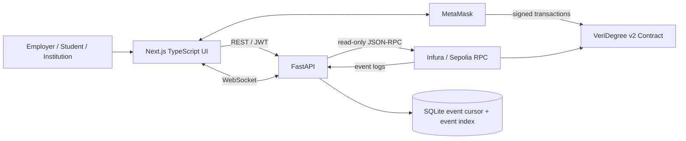

# VeriDegree v2 — Technical Design Document

## 1. Architecture



The browser connects to MetaMask for wallet identity and all state-changing contract transactions. The FastAPI backend uses a read-only RPC client for verification, credential history, institution approval checks, wallet-signature authentication, and event polling. The backend broadcasts normalized contract events to connected browsers over WebSocket. The contract remains the source of truth.

## 2. Tech stack

| Layer | Technology | Purpose |
|---|---|---|
| Smart contract | Solidity 0.8.24 | Credential registry, permissions, multisig and events |
| Contract tooling | Hardhat 2 + ethers.js v6 | Compile, test, deploy and verify |
| Backend | Python 3.10+, FastAPI, Uvicorn | JSON API and WebSocket event delivery |
| Blockchain client | Web3.py 7.x, eth-account | Sepolia read calls, log polling and signature recovery |
| Backend state | SQLite | One-time challenges, event cursor and de-duplicated event index |
| Frontend | Next.js 16 App Router, React 19, TypeScript | Responsive application screens |
| Browser blockchain client | ethers.js v6 | MetaMask connection, wallet signatures and contract writes |

Exact installed dependency versions are recorded in `backend/requirements.txt` and `frontend/package.json`. Run the project checks after installing dependencies; this source archive does not include virtual environments or `node_modules`.

## 3. Smart contract

- **Network:** Sepolia (chain ID `11155111`).
- **Contract address:** `0x1d355800fFA522d654cFd5186B6eE213aA292e75`.
- **Explorer:** https://sepolia.etherscan.io/address/0x1d355800fFA522d654cFd5186B6eE213aA292e75
- **Source:** `contracts/VeriDegree.sol`.
- **ABI used by the app:** `backend/app/abi/VeriDegree.json` and `frontend/src/lib/VeriDegree.abi.json`.

### Functions used by the app

| Function | Called by | Purpose |
|---|---|---|
| `approvedInstitutions(address)` | Backend | Check current issuer approval |
| `isAdmin(address)` | Backend | Identify current contract admins at sign-in |
| `credentialIdPlusOneByHash(bytes32)` | Backend | Look up a unique file digest without confusing ID 0 with not-found |
| `verifyCredential(uint256)` | Backend | Read credential record and revocation flag |
| `verifyCredentialByHash(bytes32)` | Available ABI / public verification | Hash-based credential lookup |
| `getStudentCredentialsPage(address,uint256,uint256)` | Backend | Read a bounded page plus one look-ahead ID to determine whether another page exists |
| `issueCredential(bytes32,address)` | Institution MetaMask | Issue a hash-backed credential |
| `revokeCredential(uint256)` | Institution MetaMask | Direct revocation by the currently approved original issuer |

The deployer key is not used by the web app. Institution transactions are signed in MetaMask. Admin governance remains a separate 2-of-3 on-chain workflow and is not a custodial backend action.

### Relevant events

`CredentialIssued`, `CredentialRevoked`, `CredentialStudentUpdated`, `InstitutionAdded`, `InstitutionRemoved`, `AdminReplaced`, `ProposalCreated`, `ProposalConfirmed`, `ProposalExecuted`, and `ProposalCancelledEvent`.

A `CredentialRevoked` event whose `revokedBy` equals the contract address represents an emergency multisig action. The UI labels it as admin-multisig activity rather than treating the contract address as an issuer wallet.

## 4. Backend API

Run from `backend/` with `uvicorn app.main:app --reload --port 8000`.

| Method | Path | Purpose |
|---|---|---|
| GET | `/api/health` | API, RPC and chain status |
| POST | `/api/auth/challenge` | Create a random, one-time, five-minute wallet challenge |
| POST | `/api/auth/verify` | Verify EIP-191 signature, consume nonce, read role and return short-lived JWT |
| GET | `/api/auth/me` | Re-read current role/issuer approval |
| POST | `/api/verify/upload` | SHA-256 exact uploaded bytes, map digest to credential, report status |
| GET | `/api/credentials/{credential_id}` | Public credential read |
| GET | `/api/students/{address}/credentials?offset=0&limit=20` | Paginated credential history (limit max 25; response includes `hasMore`) |
| GET | `/api/institutions/{address}/status` | Current approval and explicitly untrusted display metadata |
| GET | `/api/institution/credentials/{credential_id}` | Protected record lookup for an authenticated issuer/admin session |
| GET | `/api/events?limit=20` | Most recent indexed chain events |
| WebSocket | `/ws/events` | Live event stream and heartbeat |

### Verification response semantics

- `valid`: file hash exists, credential is not revoked, and issuer remains approved.
- `revoked`: hash exists but credential is revoked.
- `issuer_unapproved`: hash exists and credential is not revoked, but issuer is not currently approved.
- `not_found`: no credential is registered for the exact file bytes.

`verifyCredential.isValid` still means only `!revoked`; the backend and frontend separately evaluate `issuerApproved`. The backend validates the filename extension, declared MIME type and file signature, and never saves the uploaded file. The upload size is bounded by `MAX_UPLOAD_MB`. The frontend performs the same checks for an early user-facing message, but the backend remains the enforcement point.

## 5. Event handling

The backend polls bounded Sepolia block ranges using Web3.py and waits for the configured confirmation buffer (`EVENT_CONFIRMATIONS`, default 3) before publishing events. The first run auto-detects the contract creation block when `CONTRACT_DEPLOYMENT_BLOCK=-1`; alternatively set the actual creation block in `backend/.env`. The last scanned block, its canonical block hash, and de-duplicated normalized events are stored in SQLite. Each newly confirmed event is broadcast over `/ws/events` to open frontend sessions.

On restart, the listener resumes after the saved cursor and compares the saved checkpoint hash with the canonical chain. If a mismatch is detected, it searches recent checkpoints for a common ancestor, removes cached events after that block and scans the replacement range again. If no retained ancestor is found, it rebuilds the event index from the deployment block. If an RPC request fails, the listener logs the error and retries on the next poll without advancing the cursor. Polling uses `EVENT_POLL_SECONDS`, `EVENT_BLOCK_STEP`, `EVENT_CONFIRMATIONS` and `EVENT_REORG_CHECKPOINTS`. The browser refreshes the persisted event feed after a reorganisation notice; the contract remains authoritative.

## 6. Frontend

### Routes

- `/` — premium product landing page and product story.
- `/verify` — public employer certificate upload and result page.
- `/institution` — signed-in institution workspace for credential issuance and direct revocation.
- `/student` — wallet-linked credential list with pagination.

The design direction combines an editorial luxury tone with a restrained dark-green / warm-stone palette, serif display accents, fine grid details, a CSS 3D credential object, and subtle orbital motion. Motion is decorative and respects `prefers-reduced-motion`; forms remain direct and readable.

### Wallet behavior

- MetaMask is requested only after a user action.
- The UI requires Sepolia chain ID `11155111` for contract writes and asks MetaMask to switch. If Sepolia is not configured in MetaMask, it explains that the user must add the network manually.
- Account/chain changes clear the in-memory sign-in session.
- An institution signs a human-readable, domain-bound, five-minute challenge; the backend recovers the signer, consumes the nonce, and checks current institution approval on-chain.
- User rejection is shown distinctly from RPC/contract failures.
- Each issue/revoke transaction displays MetaMask approval, pending hash, confirmed result, or failure.

### Live UI updates

The `LiveActivity` component connects to `NEXT_PUBLIC_WS_URL`, displays new normalized event messages, and reconnects when the socket closes. The event feed does not claim transaction success before the WebSocket or receipt reports it.

## 7. Custody and key handling

| Secret / key | Holder | Storage | Use |
|---|---|---|---|
| Institution private key | Institution | MetaMask only | Signs issue/revoke transactions |
| Three admin private keys | Administrators | Their separate wallets | 2-of-3 governance actions |
| Deployer key | Deployer | Root Hardhat `.env` only | Deployment; not used by FastAPI or Next.js |
| Sepolia RPC URL | Developer/backend operator | `backend/.env` | Read-only RPC access and event polling |
| Backend `SESSION_SECRET` | Backend operator | `backend/.env` | Signs short-lived JWT sessions |
| Etherscan API key | Developer | Root `.env` only | Contract source verification |

Frontend `NEXT_PUBLIC_*` variables contain only public chain/address/API configuration. The backend is not given any wallet private key and does not sign contract transactions.

## 8. Security and trust assumptions

- Contract permissions remain authoritative; hiding a page in the frontend is not an access-control mechanism.
- Wallet challenges are random, stored server-side, address-bound, single-use, short-lived, and verified with EIP-191 message recovery.
- Protected institution requests re-check current approval/admin status on-chain.
- Certificate uploads are size-bounded, hashed in memory, and not persisted.
- Hashing is SHA-256 of exact bytes. Re-exported or scanned copies may not match the original fingerprint.
- Issuer approval and revocation are separate facts. A non-revoked credential from an institution that has since been removed is not presented as fully valid.
- Institution names are untrusted display metadata and are never presented as evidence of real-world accreditation.
- Student and issuer addresses, credential hashes, timestamps and revocation metadata are public on-chain.
- RPC availability, MetaMask availability, user rejection, incorrect network, and expired sessions can interrupt app flows and are surfaced to the user.
- This is a classroom project implementation, not an independent third-party security audit or a production identity/KYC system.

## 9. Extension: Wallet sign-in

1. The browser requests `/api/auth/challenge` for its connected wallet.
2. The backend creates a cryptographically random nonce and a domain/address/chain-bound message with a five-minute expiry.
3. MetaMask signs the message; no transaction and no gas payment are required.
4. The backend recovers the signing address with `eth-account`, compares the exact message, and consumes the nonce once.
5. The backend reads `approvedInstitutions(address)` and `isAdmin(address)` from Sepolia.
6. It returns a short-lived bearer session identifying the role. The session is held in application memory and is not a substitute for a transaction signature.
7. Every state-changing contract call is still made from the user's MetaMask wallet.

## 10. Configuration

| Variable | Used by | Secret? | Notes |
|---|---|---|---|
| `SEPOLIA_RPC_URL` | Backend + Hardhat root | Treat as provider credential | Do not use in frontend `NEXT_PUBLIC_*` |
| `CONTRACT_ADDRESS` | Backend | No | Deployed v2 contract address |
| `CONTRACT_DEPLOYMENT_BLOCK` | Backend | No | `-1` means auto-detect on first run |
| `SESSION_SECRET` | Backend | Yes | Random value, at least 32 characters |
| `APP_DOMAIN` | Backend | No | Wallet challenge domain, e.g. `localhost:3000` |
| `CORS_ORIGINS` | Backend | No | Comma-separated allowed browser origins |
| `DATABASE_PATH` | Backend | No | Local SQLite state file |
| `EVENT_POLL_SECONDS` | Backend | No | Event polling interval |
| `EVENT_BLOCK_STEP` | Backend | No | Maximum range per poll |
| `MAX_UPLOAD_MB` | Backend | No | Public upload size limit |
| `NEXT_PUBLIC_CHAIN_ID` | Frontend | No | `11155111` |
| `NEXT_PUBLIC_CONTRACT_ADDRESS` | Frontend | No | Deployed contract address |
| `NEXT_PUBLIC_API_BASE_URL` | Frontend | No | Local API, default `http://localhost:8000` |
| `NEXT_PUBLIC_WS_URL` | Frontend | No | Local WebSocket, default `ws://localhost:8000/ws/events` |

Hardhat deployment/verification variables remain documented in the root `.env.example` and must not be copied into the running frontend.

## 11. Testing

The repository includes:
- Hardhat contract tests in `test/VeriDegree.test.js` (the project owner reported 50 passing after the latest contract refactor; the Solidity source was not changed in this V5 cleanup).
- Backend unit tests in `backend/tests/` (15 passed in the packaging environment). Two additional event-listener tests were added for confirmation buffering and reorganisation rollback; they require the Web3.py dependency and must be run after installing `backend/requirements.txt`.
- Frontend TypeScript/TSX syntax transpilation check (21 source files passed in the packaging environment); this is not a substitute for a full Next.js type-check, lint, or production build.
- API docs at `/docs` for manual endpoint tests.

Before marking full-stack acceptance complete, run:

```powershell
# from backend/
python -m compileall app tests
pytest

# from frontend/
npm install
npm run lint
npm run build
```

Then run a live Sepolia test with an approved institution wallet: sign in → issue → wait for event → upload the same file → revoke → upload again and confirm `revoked`. Also test an unapproved wallet, a duplicate hash, a wrong network, rejected MetaMask signature, and a removed issuer. The source package has not been live-tested against the user's local RPC/MetaMask setup; record actual results after these steps.

## 12. Contract changes since the Solidity course

See [`CONTRACT_CHANGES.md`](CONTRACT_CHANGES.md). The deployed v2 contract has a new ABI; the old contract address is unchanged and does not contain the v2 changes.

## 13. Known limitations and next steps

- The frontend production build and complete user-device end-to-end tests must be run locally before final submission. The packaging environment could not install the full Web3.py/Next.js dependencies because the package registries were unreachable; 15 backend tests and TypeScript/TSX syntax parsing were completed here, while the two Web3-dependent event tests remain to be executed locally.
- SQLite is suitable for this local classroom demo, not a multi-instance production deployment.
- The event listener uses polling with a configurable confirmation buffer and recent-block reorganisation reconciliation; a provider outage delays live event delivery until polling resumes.
- The browser holds the wallet session in memory; reload requires another signed challenge.
- The admin governance lifecycle is intentionally not exposed as a dedicated app screen; use the contract's 2-of-3 governance functions.
- Credential hashes identify exact byte sequences, not visually equivalent documents.
- If two admin keys are lost, 2-of-3 quorum cannot recover itself.

## 14. Acknowledgements

Record the official documentation, libraries, tutorials, and AI assistance actually used during development and be prepared to explain each module. Update exact dependency versions and actual test/build results after local installation.
